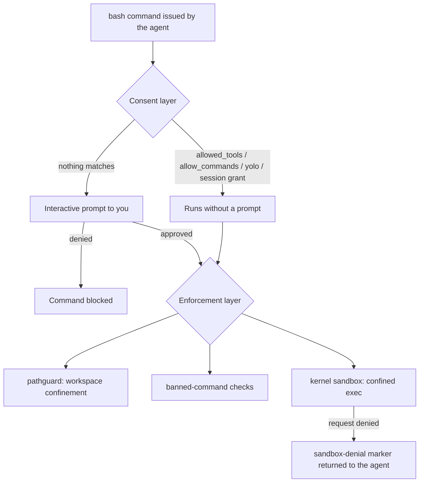
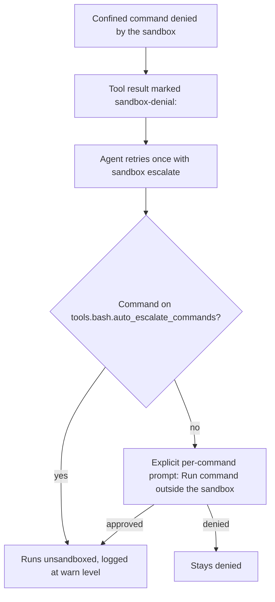

# Vibe Coding: A High-Trust Single-Workspace Setup

This recipe wires up Phosphor for one programmer in one workspace they own:
the everyday loop — read code, edit files, `go build`, `go test`, `git
commit`, `gh pr create` — runs **without a single permission prompt**, while
the kernel sandbox, pathguard, and secret redaction keep containing the
blast radius whether you notice it or not.

The example is written for a Go project using `git` and `gh`; the
[same recipe for other toolchains](#other-toolchains) is a one-line swap.

Complete files:
[`examples/vibe-coding.global.json`](../examples/vibe-coding.global.json)
and
[`examples/vibe-coding.project.json`](../examples/vibe-coding.project.json).

## The mental model: consent vs. enforcement

Phosphor has two independent layers, and this setup deliberately moves all
the *deciding* into one of them while leaving the other untouched:

| Layer | Question it answers | Can this setup change it? |
|---|---|---|
| **Consent layer** | "Do I need to ask you?" — prompts, allow-lists, session grants, YOLO | Yes — that's the whole point |
| **Enforcement layer** | "Is this allowed at all?" — kernel sandbox, pathguard, banned commands, secret redaction | No — never, by any permission grant |

Every opt-in below silences prompts. Not one of them relaxes a boundary.



The enforcement layer evaluates the *same* command on its own terms
regardless of where the consent decision landed — a granted prompt is never
a granted boundary.

## The setup: two files, one trust line

Phosphor merges a **global config** (yours, `~/.config/phosphor/phosphor.json`)
with a **project config** (the repo's, `phosphor.json` at the working-tree
root). Some security fields are *operator-floored*: they can only be set or
tightened from the global file, and a workspace may narrow them but never
widen them (a downgrade attempt is reverted with a warning). That draws the
trust line for this setup:

| File | Holds | Why |
|---|---|---|
| Global (`~/.config/phosphor/phosphor.json`) | `tools.bash.*` trust decisions | `sandbox_mode`, `auto_escalate_commands`, `trust_toolchain_caches`, `allowed_env`, `trusted_extra_roots` are operator-only |
| Project (`./phosphor.json`) | `permissions.*` | Prompt-silencing only; safe to commit and share with your team |

### Global config — the trust grants

```json
{
  "$schema": "https://raw.githubusercontent.com/hackafterdark/phosphor/main/schema.json",
  "tools": {
    "bash": {
      "sandbox_mode": "workspace",
      "auto_escalate_commands": ["git", "gh", "go"],
      "trust_toolchain_caches": true,
      "sandbox_limits": { "max_procs": 512, "max_file_mb": 1024 }
    }
  }
}
```

- **`sandbox_mode: "workspace"`** — the default (unset also means
  `workspace`), stated here so the file is self-documenting. Bash children
  run kernel-confined to the workspace filesystem. `strict` upgrades this to
  "refuse to exec when the sandbox cannot attach"; only `"off"` in this same
  global file disables the sandbox, and a project file can never override
  any of these three choices downward.
- **`auto_escalate_commands: ["git", "gh", "go"]`** — pre-grants the
  sandbox-escalation prompt for these commands. `git` and `gh` *must* reach
  host credentials (`~/.ssh`, git credential helpers, `GITHUB_TOKEN`) and
  the network, which the sandbox denies; without this list every `git
  commit` would stop for a per-command escalation prompt. The trust anchor
  for the list is blunt: put on it exactly the commands you would run
  yourself without reading their arguments. Prefix entries for finer
  control — `["go build", "go test"]` pre-approves those but still prompts
  for `go run <anything>`. Compound commands (`git add -A && git commit`)
  are covered only when *every* program matches.
- **`trust_toolchain_caches: true`** — widens the writable path set to the
  language-runtime cache roots (`~/.npm`, `~/.cache/pip`, `~/.cargo/...`,
  `~/.m2/repository`, `~/.gradle/...`) plus `GOMODCACHE`, so workspace
  builds keep working inside the sandbox. Security-relevant home paths
  (`~/.ssh`, `~/.aws`, browser profiles) stay outside the writable set
  either way.
- **`sandbox_limits`** — optional kernel resource caps so a runaway build
  can't fork-bomb or fill your disk. Omit for no caps.

### Project config — the consent shortcuts

```json
{
  "$schema": "https://raw.githubusercontent.com/hackafterdark/phosphor/main/schema.json",
  "permissions": {
    "allowed_tools": [
      "view", "ls", "glob", "grep", "workspace_search",
      "structural_search", "lsp_diagnostics", "lsp_references",
      "todos", "scan_secrets",
      "edit", "multiedit", "append", "write"
    ],
    "allow_commands": [
      "git", "gh",
      "go build", "go test", "go vet", "go mod",
      "gofumpt", "golangci-lint"
    ]
  }
}
```

- **`allowed_tools`** — the read/inspect tools plus the file-editing tools.
  Edits stay inside the workspace (pathguard), the workspace is git-tracked,
  and `git checkout` undoes any damage — that's the argument for including
  `edit`/`write` here in a high-trust setup. Leave anything you're less
  comfortable with (e.g. `bash` itself, `web_fetch`) off the list and it
  keeps prompting.
- **`allow_commands`** — argument-level auto-approval for the toolchain and
  git/gh. A bare name (`git`) covers every invocation; a prefix (`go build`)
  covers that subcommand only; compound commands prompt unless every part
  matches; anything the parser can't statically verify (command
  substitution, subshells) falls through to the prompt. This silences the
  *prompt* only — the sandbox still runs the command.

With both files in place, launch with `phosphor --yolo` (or press `ctrl+y`)
if you want *zero* prompts even for the off-list tools — or skip `--yolo`
and let the allow-lists carry the loop while anything unusual still asks.
Note that `--yolo` and session grants still never grant sandbox
escalation; only `auto_escalate_commands` does that, deliberately.

## How escalation works

The sandbox is a policy ceiling, never a permission gate. When a confined
command touches something outside its allowance (git reaching `~/.ssh`, `go
build` reaching the build cache), the flow is:



Three properties worth internalizing:

1. **The escalation prompt bypasses every shortcut.** YOLO mode, tool
   allow-lists, hook pre-approvals, auto-approved sessions, and session
   permission caches all *never* grant it — unless the command is on
   `auto_escalate_commands`, where the operator pre-granted it at config
   time.
2. **Escalation is per-command and observable.** The bash tool span carries
   `phosphor.security.sandbox_mode`, `phosphor.security.sandbox_escalated`,
   and `phosphor.security.sandbox_escalation_denied`, and every unsandboxed
   escalation logs at warn level: `Sandbox escalation approved by user;
   running unsandboxed`.
3. **A permission grant is never a de-escalation.** Approving `git push`
   says nothing about whether it runs sandboxed; those are separate
   decisions on separate layers.

## What this setup can never relax

No matter what `permissions`, `--yolo`, or session grants say:

| Boundary | Enforced by |
|---|---|
| File access confined to the workspace | pathguard + kernel sandbox |
| Banned/dangerous commands (`shutdown`, fork bombs, network utilities) | bash command policy |
| Inline interpreter payloads (`sh -c '<payload>'`), `wsl`, host shells | escape-hatch gating |
| Secret material reaching the model or the wire | redaction stack (on by default) |
| Credential paths (`~/.ssh`, `~/.aws`, `.env`) | deny-read + sensitive-file redaction |
| Sandbox-escalation decisions | explicit prompt or `auto_escalate_commands` |

## When prompts still appear

Auto-approval of escalations is argv-verified and deny-by-default. Even with
the setup above, a prompt is *correct* behavior in these cases:

| Command | Why it prompts |
|---|---|
| `rm .git/index.lock && git add .` | Compound command — `rm` isn't allowlisted, and **every** program in a compound must match |
| `git commit -m "$(cat <<'EOF' ...)"` | Contains a command substitution — `$(...)` can't be statically verified, so the whole command falls through to the prompt |
| `rm somefile` | `rm` isn't on `auto_escalate_commands` |

The same strictness applies to `permissions.allow_commands` — both lists
reuse the argv parser, so neither can be tricked by dynamic program names,
subshells, or substitutions. If your workflow routinely uses heredoc-style
commit messages, either accept the occasional prompt or keep commit
message handling in the agent's hands (`git commit -m "plain text"`).

### Network egress

The workspace sandbox confines the **filesystem**, not the network — `gh
pr create` and `git push` reach GitHub from inside the sandbox without any
extra config. If your loop uses raw network utilities (`curl`, `wget`,
`nc`, `ssh`), those are blocked by default and gated by a separate opt-in
policy:

```json
{
  "tools": {
    "bash": {
      "network": {
        "enabled": true,
        "allowed_commands": ["curl", "wget"],
        "host_allowlist": ["github.com", "api.github.com"]
      }
    }
  }
}
```

Put this in the global config like the other `tools.bash.*` trust grants.
`host_allowlist` supports exact hosts, `.suffix` wildcards, and CIDR
ranges; link-local/metadata ranges stay hard-denied regardless.

## Verifying the setup

- `phosphor_info` shows the `[sandbox]` report — what is actually active,
  including whether a config value was reverted as an illegal downgrade.
- `phosphor_logs` shows revert warnings like
  `Ignored workspace/project override that would weaken a security setting`
  if a checked-out repo ever tried to loosen your floor.
- Escalation decisions appear at warn level, so you can audit exactly which
  commands ran unsandboxed.

## Other toolchains

The recipe is toolchain-neutral — swap the allow-lists:

| Toolchain | `allow_commands` (project) | `auto_escalate_commands` (global) |
|---|---|---|
| Go | `go build`, `go test`, `go vet`, `go mod`, `gofumpt` | `go` |
| Rust | `cargo build`, `cargo test`, `cargo clippy` | `cargo` |
| Node | `npm run`, `npm test`, `npm install`, `npx` | `npm`, `npx` |
| Python | `pytest`, `ruff`, `mypy` | `python`, `pip` |

For any of them, `git` and `gh` stay on both lists, and
`trust_toolchain_caches: true` covers the npm/pip/cargo/Maven/Gradle cache
roots automatically.

## See also

- [security/CONFIGURATION.md](security/CONFIGURATION.md) — every security
  control, the full evaluation-order table, and the kernel sandboxing
  details.
- [security/WORKSPACE_HARDENING.md](security/WORKSPACE_HARDENING.md) — the
  workspace threat model behind pathguard.
- [adr/0016-os-level-sandboxing.md](adr/0016-os-level-sandboxing.md) — why
  the enforcement layer is kernel-side.
