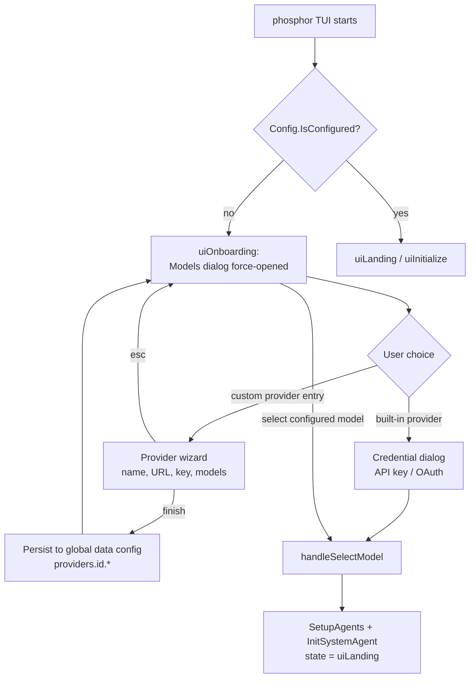

# Provider Onboarding Flow

This document describes what happens the first time Phosphor is started
in a workspace on a machine with no usable provider configuration, and
how the custom (local/self-hosted) provider path fits into it.

## The gate: `Config.IsConfigured()`

Everything hinges on one check:

```go
// pkg/config/config.go
func (c *Config) IsConfigured() bool {
	return len(c.EnabledProviders()) > 0
}
```

If no provider is enabled (no global config, no data config, no project
`phosphor.json` with providers), the app refuses to initialize the agent
(`internal/app/app.go`) and the TUI routes straight into onboarding
(`internal/ui/model/ui.go`, `desiredState = uiOnboarding`).

## The onboarding screen

Onboarding is **the `Models` dialog rendered in onboarding mode**
(`internal/ui/dialog/models.go`, `NewModels(com, isOnboarding)`).
`UI.Init()` force-opens it whenever the state is `uiOnboarding`.

Input is captured at two layers:

1. `handleKeyPressMsg` routes *every* message to the dialog overlay
   while `m.dialog.HasDialogs()` is true, so global keys (including
   `ctrl+p`, the main command menu) never fire.
2. The dialog itself is inescapable: `esc` returns `ActionClose`, but
   `handleDialogMsg` swallows it while the `Models` dialog is the front
   dialog in onboarding and re-opens the dialog otherwise.

Selecting a provider/model chains into the credential dialogs
(`openAuthenticationDialog` → `NewOAuthHyper` / `NewOAuthCopilot` /
`NewAPIKeyInput`). Completing the flow calls `handleSelectModel`, which
flips the state to `uiLanding`, and initializes the system agent (the
config store's `autoReload` runs `SetupAgents()` as soon as the first
provider makes the config usable).

## The chicken-and-egg problem

The custom provider wizard (`internal/ui/dialog/provider_wizard.go`,
opened via `Ctrl+P` → *Add Custom Provider*) is only reachable from the
main command menu. But the command menu cannot be opened during
onboarding because the onboarding dialog intercepts all input. So a
user running local models (Ollama, vLLM, llama.cpp, LM Studio, …) had
no way to configure their endpoint inside the app — they had to
first authenticate a cloud provider, or hand-edit
`$XDG_DATA_HOME/phosphor/phosphor.json` outside the TUI.

## The fix: custom provider entry in the onboarding list

The onboarding provider list now starts with a synthetic
*Set up a custom provider* entry. Selecting it emits
`ActionOpenDialog{DialogID: ProviderWizardID}`, which opens the
existing 6-step wizard (name → base URL → API key → model IDs →
context window → attachments) directly on top of the onboarding screen:

- The dialog is a framed, centered box with fixed dimensions: the
  summary panel lists every field (provider, url, api key, models,
  context, attachments) on every step, so collected values appear as
  the user progresses and the box never resizes.
- The context-window step takes a positive token count and is skippable
  (empty input).
- The attachments step is a yes/no radio selector (arrows move, enter
  confirms), so the stored value is always a valid boolean.
- The same fields are editable later via *Manage Custom Providers*
  (`context_window` and `supports_attachments` rows on each model).
  `pkg/config/custom_provider_capabilities_test.go` pins that both
  fields survive the config load pipeline.
- An unset `context_window` (0) silently disables context compaction —
  `shouldSummarize` in `pkg/agent/agent.go` skips summarization when
  the window is zero — so the value is worth filling in.

- The wizard always renders as a framed, centered dialog — even during
  onboarding — so it stays visually distinct from the provider picker
  behind it.
- While the wizard is the front dialog, `esc` closes *it* and returns
  to the provider list (it remains swallowed only for the provider
  picker itself, so onboarding stays inescapable). This also applies to
  the API-key/OAuth dialogs opened on top of the picker — `esc` there
  steps back to the provider list instead of doing nothing.
- Finishing the wizard persists the provider to the global data config
  (`setupProvider` → `SetConfigField(ScopeGlobal, …)`), then closes the
  wizard and refreshes the provider list so the new provider's models
  appear immediately.
- Finishing the wizard auto-selects the first configured model as the
  large model (mirroring the API-key dialog, which selects the model
  the user was on). `handleSelectModel` then records `models.large` in
  the workspace config, defaults the small model to the same one,
  initializes the system agent, and leaves onboarding — so image paste
  (`currentModelSupportsImages`, which resolves through the agent's
  large model) works immediately after setup.
- The user then picks one of those models; `handleSelectModel` sees the
  provider is configured, skips authentication, sets large/small model
  preferences (custom providers fall back to the large model as the
  small model, `internal/app/app.go`, `GetDefaultSmallModel`), and
  leaves onboarding normally.

## Flow diagram



## Why not open the whole command menu during onboarding?

Items like Sessions, Skills, Prune, or Codebase Index require the
workspace system agent, which is only initialized after a provider is
selected (`InitSystemAgent` runs at the end of `handleSelectModel`).
Exposing the full menu there would offer actions that cannot run yet.
The single, targeted *Set up a custom provider* entry gives local-model
users the escape hatch without pretending the rest of the app works
before a provider exists.

## Files involved

| File | Role |
| --- | --- |
| `internal/ui/model/ui.go` | state machine, dialog routing, `setupProvider`, `openProviderWizardDialog` |
| `internal/ui/dialog/models.go` | provider/model picker (the onboarding screen) |
| `internal/ui/dialog/provider_wizard.go` | custom provider setup wizard |
| `internal/ui/dialog/provider_manager.go` | custom provider management (post-onboarding) |
| `internal/ui/dialog/api_key_input.go`, `oauth.go` | credential capture |
| `pkg/config/config.go`, `pkg/config/load.go`, `pkg/config/store.go` | provider schema, validation, persistence |
| `internal/app/app.go` | `IsConfigured` gate, `GetDefaultSmallModel` fallback |

## Testing

`internal/ui/dialog/models_onboarding_test.go` covers the synthetic
entry: presence only during onboarding, that selecting it returns
`ActionOpenDialog{ProviderWizardID}`, and that built-in providers remain
listed alongside it.

Note: in sandboxes where `~/.local/share/phosphor` is unwritable, set
`PHOSPHOR_DISABLE_PROVIDER_AUTO_UPDATE=1` when running the suite —
otherwise `config.Providers` fails trying to refresh the provider cache.